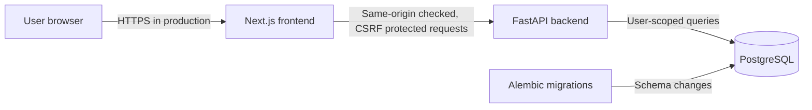

# Architecture

## Current system

The repository is a small web application with a separately deployable
frontend and API. PostgreSQL is the relational datastore. The current V1
vertical slice provides first-account setup, private sessions, and activity
tracking.

## Components

### Frontend

- Next.js App Router with TypeScript in `frontend/`.
- Owns the browser experience and calls the backend API with credentialed
  requests.
- The activity dashboard and authentication gate live in `frontend/app/page.tsx`;
  shared API calls and CSRF handling live in `frontend/lib/api.ts`.
- CORS on the API is configured for the single `FRONTEND_ORIGIN` setting.

### Backend

- FastAPI application entry point: `backend/app/main.py`.
- Authentication routes: `backend/app/api/auth.py`.
- Activity and category routes: `backend/app/api/activities.py`.
- Health routes: `backend/app/api/health.py`.
- Settings: `backend/app/core/config.py`.
- SQLAlchemy base and session setup: `backend/app/db/`.
- Authentication dependencies resolve an opaque cookie session to a user.
- Activity, category, subcategory, and summary operations filter by that user;
  composite foreign keys also prevent cross-owner references.

### Database and migrations

- PostgreSQL is provided for local development by the root
  `docker-compose.yml`.
- SQLAlchemy is the backend database toolkit and ORM.
- Alembic reads the SQLAlchemy metadata from `backend/app/db/base.py`.
- The initial migration creates users, sessions, the setup singleton,
  categories, subcategories, and activities.

## Runtime and health checks

- `GET /health` is a liveness check and does not require the database.
- `GET /health/ready` checks database connectivity and returns HTTP 503 when
  PostgreSQL is unavailable.
- `/docs` exposes FastAPI's interactive API documentation in development.

## Configuration and trust boundaries

- Local backend settings are read from `backend/.env`; frontend settings are
  read from `frontend/.env.local`.
- Example files document development configuration only. Production secrets
  must be supplied by the deployment environment or secret manager.
- The browser is an untrusted client. The API must validate inputs and enforce
  authorization for every protected operation.
- The first account is created through a one-time setup endpoint; public
  registration is disabled after setup.
- Passwords use Argon2id. Opaque random session tokens are stored as SHA-256
  hashes. Browser sessions use HttpOnly, SameSite=Strict cookies; unsafe
  requests require the configured exact origin and a session-bound CSRF token.
- Production mode requires Secure session cookies and disables interactive API
  documentation. Deployment must use HTTPS and add infrastructure-level
  request rate limiting.
- User-owned records are filtered and mutated only within the authenticated
  user's scope. Never rely on a client-supplied user identifier as
  authorization.
- Do not add a paid external service without explicit product configuration and
  documented operational requirements.

## Local development

See the repository `README.md` for PostgreSQL, backend, and frontend startup
instructions. The frontend and backend can be run separately; Compose currently
starts the database only.

## Architectural evolution

Keep the initial system modular and simple. Introduce additional services,
queues, caches, or deployment infrastructure only when an approved feature or
measured operational need requires them. Record material changes to data
ownership, API boundaries, or deployment topology here.
